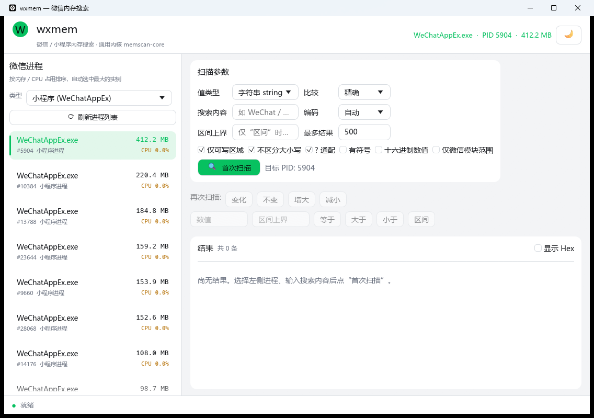
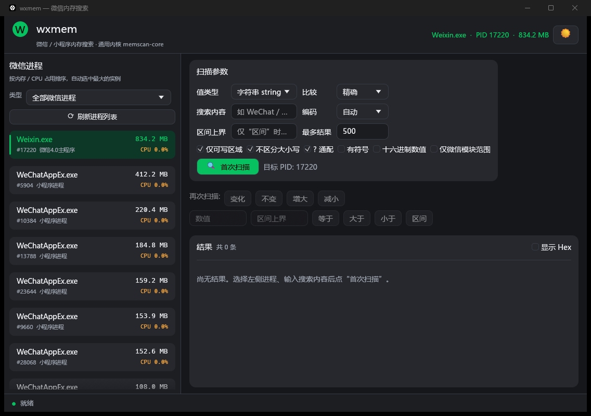

# memscan

微信 / 微信小程序进程内存搜索工具，同时提供一个通用、可复用的内存搜索引擎。
搜索模型以 **Cheat Engine**（`memscan.pas`）为准。

> 仅用于本地授权的安全研究与调试。搜索内核与微信无关，可复用于任意进程。

---

## 两个 crate

| crate | 类型 | 说明 |
| --- | --- | --- |
| `crates/memscan` | 库 | ★ **核心包**：通用进程内存搜索引擎（CE 风格），平台无关。 |
| `crates/wxmemscan` | GUI 程序 + 库 | ★ **专门搜 wx 进程内存的桌面程序**，可直接使用；同时是 `memscan` 的完整使用示例。 |

`wxmemscan` 里包含两个“示例入口”：

* `src/main.rs`：egui/eframe 桌面界面，展示首扫 / 再次扫描 / 结果读取；
* `examples/headless_wx_scan.rs`：不启动 GUI，直接用 `memscan` API 搜索微信进程内存。

---

## 设计目标

1. **搜索逻辑与微信解耦**：`memscan` 是独立、通用、可复用的库，任意进程都能扫。
2. **分层清晰**：核心库 `memscan` + 应用/示例 `wxmemscan`。
3. **跨平台**：Windows / macOS / Linux 统一走成熟 crate，不自己维护各平台 FFI：
   * 读 / 写内存：[`process-memory`](https://crates.io/crates/process-memory)
   * 内存区域枚举：[`proc-maps`](https://crates.io/crates/proc-maps)
   * 进程枚举：[`sysinfo`](https://crates.io/crates/sysinfo)
4. **以 CE 为准**：值类型、扫描选项、首次 / 再次扫描、区域过滤、AOB 通配符等语义对齐 CE。
5. **性能**：SIMD 子串匹配、分块读取 + 边界重叠、4 KiB 页缓存、rayon 并行、结果 arena 存储。

## 目录结构

```
memscan/
├── Cargo.toml                 # workspace
├── crates/
│   ├── memscan/               # ★ 核心包：通用进程内存搜索引擎
│   │   └── src/
│   │       ├── address.rs     #   Address 类型
│   │       ├── types.rs       #   VariableType/ScanOption/ScanType/...（对齐 CE 枚举）
│   │       ├── value.rs       #   NumericValue 解析/读取/比较
│   │       ├── pattern.rs     #   AOB/字符串模式匹配（nibble 通配 + SIMD）
│   │       ├── region.rs      #   MemoryRegion / RegionFilter
│   │       ├── process.rs     #   ProcessInfo / ModuleInfo
│   │       ├── progress.rs    #   ScanControl（原子进度 + 取消）
│   │       ├── result.rs      #   FoundList（arena 存储）
│   │       ├── scanner.rs     #   MemScan：首扫 / 再次扫描 / 分块 / 并行
│   │       ├── backend.rs     #   process-memory + proc-maps + sysinfo（唯一后端）
│   │       └── ...
│   └── wxmemscan/             # ★ 微信进程内存搜索 GUI（也是 memscan 的示例）
│       └── src/
│           ├── main.rs        #   egui/eframe 桌面界面
│           ├── lib.rs         #   导出微信进程识别层
│           └── wechat/        #   WeChatKind / 分类器 / find_wechat_processes
└── docs/                      # 截图
```

## 构建与运行

需要 Rust 稳定版（`rustc 1.95+`）。

```bash
cargo build                                  # 调试构建整个 workspace
cargo build --release -p wxmemscan           # 发布桌面端：target/release/wxmemscan
cargo run   -p wxmemscan                     # 直接运行 GUI
cargo test  -p memscan                       # 核心引擎单元 / 集成测试（含自扫自检）
cargo run   -p wxmemscan --example headless_wx_scan -- "WeChat"
```

## 桌面端（wxmemscan）

基于 egui/eframe 的桌面界面，运行 `cargo run -p wxmemscan`（或双击
`target/release/wxmemscan`）。

- 左侧进程列表按 **内存 / CPU 占用** 排序，**默认选中占用最大的实例**
  （可切换 小程序 / 内置浏览器 / 主程序 / Weixin / 全部微信进程）。
- 右上角 **☀ / 🌙 图标** 单击切换深色 / 浅色；启动时默认跟随系统。
- 扫描参数卡片化、结果按表格显示；扫描在后台线程执行，界面不卡顿，可随时停止。

**浅色**



**深色**



## 作为库使用 `memscan`

`memscan` 与微信无关，可直接嵌入其它项目：

```rust
use memscan::{
    Address, FirstScanRequest, MemScan, NextScanRequest, ScanControl, ScanOption, VariableType,
};

let mut scan = MemScan::attach(pid)?;                 // 打开任意进程
let mut req = FirstScanRequest::default();
req.value_type = VariableType::String;
req.value = "wechat".into();
req.case_insensitive = true;
let control = ScanControl::new();
let s = scan.first_scan(&req, &control)?;
println!("首扫命中 {}", s.matches);

// 再次扫描：只保留“变小”的值
scan.next_scan(
    &NextScanRequest { option: ScanOption::DecreasedValue, ..Default::default() },
    &control,
)?;
for (addr, bytes) in scan.found().iter() {
    println!("{addr} {:?}", bytes);
}
```

更高层的一步到位 API（`memscan::api`，已 re-export 到 crate 根）：

```rust
use memscan::{scan_text_by_name_or_pid, InstancePolicy, TextScanOptions};

// 进程名子串（或纯数字 PID）+ 模糊串
let hits = scan_text_by_name_or_pid("WeChatAppEx", "we?ha?", &TextScanOptions::default())?;
for m in &hits {
    println!("[{}] {}  {}", m.pid, m.address, m.text());
}
```

### 写内存

`ProcessBackend` 提供 `write_memory(address, &[u8])`，`memscan::open_process(pid)` 后可写：

```rust
use memscan::{open_process, Address, ProcessBackend};

let p = open_process(pid)?;
p.write_memory(Address(0x1234_5678), &100i32.to_le_bytes())?;
```

## 平台说明

- **Windows / macOS / Linux（已实现）**：读写由 `process-memory` 提供，
  内存区域由 `proc-maps` 枚举，进程列表由 `sysinfo` 收集。
- **macOS 权限**：读取其它进程需要 root 或 `com.apple.security.cs.debugger` 权限；
  即使有 root，SIP / 加固保护进程（如系统 App）也可能无法读取。这是系统限制。
- **其它平台**：暂不支持（编译时直接报错）；只维护这一套跨平台后端，不做多平台 trait 抽象。

## 与 Cheat Engine 的对应关系（节选）

| CE | 本项目 |
| --- | --- |
| `TVariableType` | `types::VariableType` |
| `TScanOption` | `types::ScanOption` |
| `TScanType` | `types::ScanType` |
| 区域过滤（writable/executable/private/image/mapped…） | `region::{MemoryRegion, RegionFilter}` |
| `FirstScan` / `NextScan`（按页 4K 分组） | `scanner::MemScan::{first_scan, next_scan}` |
| `TFastScanMethod` / `fastscanalignment` | `FirstScanRequest::align` |
| `vtByteArray` 通配符（`??` / `5?` / `?A`） | `pattern::AobPattern` |

## 已知限制

- 未知初始值（`ScanOption::UnknownValue`）会记录全进程地址，内存开销极大，建议配合地址范围或结果上限。
- 浮点 `exact` 使用逐地址比较（非位模式），`rounding` 选项未实现。
- 受保护进程可能需要更高权限；macOS 受限见上。
- `process-memory` 在 macOS 上不会主动归还 task port（每次 `open` 泄漏一个 send right）；
  常驻进程影响可忽略，但高频反复 attach 时需注意。

## 许可证

MIT.
